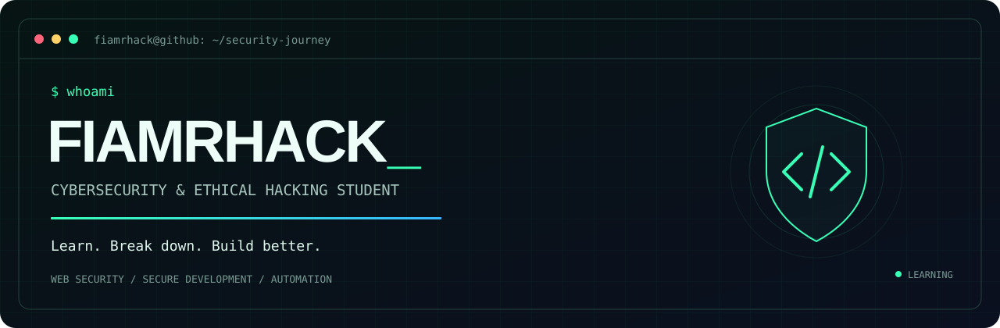

 

### Ethical Hacking Student · Web Application Security

**Learning the attack. Understanding the cause. Building the defense.**

[Security projects](#security-projects) &nbsp; / &nbsp; [Learning roadmap](#-learning-roadmap) &nbsp; / &nbsp; [Development](#-development-projects) &nbsp; / &nbsp; [Collaborate](#-connect--collaborate)

ARENA WEB SECURITY STUDENT &nbsp; • &nbsp; LEARNING IN PUBLIC &nbsp; • &nbsp; BUILDING WITH PURPOSE

---

## `01 / whoami`

I'm **FiamrHack**, a cybersecurity and ethical hacking student learning with **Arena Web Security**. I build web projects, organize course resources, and explore how application security connects to everyday development.

My approach: **understand the behavior → find the cause → learn the fix → document the lesson.**

**Currently studying:** Arena Web Security &nbsp; · &nbsp; **Practice:** Authorized labs &nbsp; · &nbsp; **Portfolio:** In progress

<table>
<tr>
<td width="50%" valign="top">

### 🔎 Exploring
Web application vulnerabilities, OWASP Top 10 concepts, authentication, sessions, and access control.

</td>
<td width="50%" valign="top">

### 🛠️ Building
Course learning resources, collaborative dashboards, web applications, and automation with AI-assisted development.

</td>
</tr>
</table>

## 🛡️ Security projects

<table>
<tr>
<td width="50%" valign="top">

### [Arena B66 Delta Archive](https://github.com/mdnhbn/arena-b66-delta-archive)

A Bengali course archive with organized classes, searchable resources, and a learning roadmap.

**Learning organization · Documentation · Resource discovery**

[Live archive ↗](https://arena-b66-delta-archive.vercel.app/) · [Source ↗](https://github.com/mdnhbn/arena-b66-delta-archive)

</td>
<td width="50%" valign="top">

### [AWS 66 Delta Tracker](https://github.com/mdnhbn/AWS-66-Delta-Shell-Upload-Project)

A collaborative dashboard for recording authorized course assignments and their outcomes.

**Structured reporting · Collaboration · Assignment tracking**

[Live dashboard ↗](https://aws-66-delta-shell-upload-project.vercel.app/) · [Source ↗](https://github.com/mdnhbn/AWS-66-Delta-Shell-Upload-Project)

</td>
</tr>
</table>

## 🧭 Learning roadmap

**Current stage: student · Practical skills and portfolio in progress**

| Track | Learning focus | Next portfolio goal |
| :--- | :--- | :--- |
| `01 / foundations` | HTTP, requests, responses, and browser–server behavior | Explain a web request through clear notes |
| `02 / web security` | Common vulnerability causes and OWASP concepts | Write authorized lab reports with mitigations |
| `03 / identity` | Authentication, sessions, permissions, and access control | Document access-control checks in training labs |
| `04 / secure code` | Input handling, secrets, and safer application design | Explain small security improvements in code |

## 💻 Development projects

| Project | Explore | Source |
| :--- | :--- | :--- |
| Affiliate Post Generator Pro | [Open app ↗](https://affiliate-post-generator-pro.vercel.app/) — affiliate content workflows; sign-in required | Private |
| BranchPilot | [Explore demo ↗](https://branchpilot-blue.vercel.app/) — gym reception prototype with synthetic data | Private |
| Eid Mubarak Wishes | [Open website ↗](https://eid-mubarak-wishes.vercel.app/) — interactive web greetings | [Repository ↗](https://github.com/mdnhbn/eid-mubarak-wishes) |

<strong>📝 My blueprint for future security write-ups</strong>

 

| Step | What the write-up should explain |
| :--- | :--- |
| Context | Authorized environment and learning objective |
| Finding | What happened and why it matters |
| Root cause | The application behavior behind the issue |
| Mitigation | How to prevent or fix the issue |
| Reflection | Lessons learned and the next question to explore |

## 🤝 Connect & collaborate

Open to **study partners, beginner-friendly projects, constructive feedback, and web security mentorship**.

**বাংলা ও English:** শেখা, নোট গুছানো এবং অনুমোদিত ল্যাবে অনুশীলনের মাধ্যমে নিজের দক্ষতা বাড়াচ্ছি।

For project questions or suggestions, start with Issues in the relevant repository when available.

---

### `> Stay curious. Think critically. Build securely._`

Practice on owned systems, authorized labs, or environments with explicit permission.

