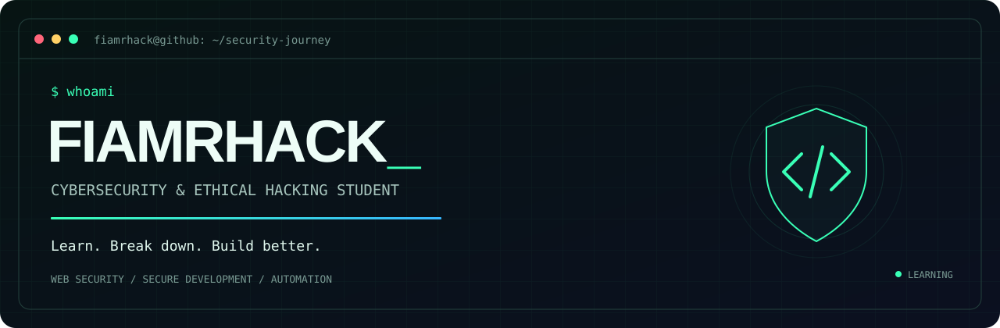

### Ethical Hacking Student · Web Application Security

**Learn with curiosity. Test with permission. Document the defense.**

[Portfolio](https://fiamrhack-portfolio.vercel.app/) &nbsp; / &nbsp; [Course archive](https://cybernest-learn.vercel.app/#classes) &nbsp; / &nbsp; [Security projects](#security-projects) &nbsp; / &nbsp; [Connect](#connect)

ARENA WEB SECURITY · AWS 66 DELTA · LEARNING IN PUBLIC

---

## Who I am

I’m **FiamrHack (MD Nazmul Hassan)**, a cybersecurity and ethical hacking student with **Arena Web Security**. I build web projects, organize learning resources, and study how to assess and improve application security.

My learning approach: **understand the behavior → find the cause → learn the mitigation → document the lesson.** I practise in authorized training environments. Course status: **in progress, nearing completion**.

## Coursework map

Topics below are drawn from the AWS 66 Delta classes listed in recording order in the CyberNest archive. This is coursework exposure, not a claim of professional certification.

| Learning area | Topics covered in class |
| :--- | :--- |
| Web application security | HTTP/HTTPS, SQL injection, XSS, file upload security, sessions, LFI and path traversal concepts |
| Tools & labs | Burp Suite Proxy/Intruder, PortSwigger labs, Acunetix setup and reporting |
| Recon & assessment | OSINT, web and directory discovery, Shodan, network testing, Nuclei and Nikto scanning, result verification |
| Platforms & defense | Linux and scripting basics, WordPress and XML-RPC security, Wordfence malware scanning, WAF and IDS concepts |
| Reporting & responsible practice | Evidence, findings, report structure, mitigation, and controlled security labs |

**Course note:** The CyberNest class list shows the 15 November live-class recording as pending; the report-writing entry notes some video parts are missing.

[Browse the class list ↗](https://cybernest-learn.vercel.app/#classes)

## Security projects

| Project | What it does | Links |
| :--- | :--- | :--- |
| **Arena B66 Delta Archive** | Bengali course archive with chronological classes, searchable resources, and a learning roadmap. | [Live ↗](https://arena-b66-delta-archive.vercel.app/) · [Source ↗](https://github.com/mdnhbn/arena-b66-delta-archive) |
| **AWS 66 Delta Tracker** | Collaborative dashboard for documenting authorized course assignments and outcomes. | [Live ↗](https://aws-66-delta-shell-upload-project.vercel.app/) · [Source ↗](https://github.com/mdnhbn/AWS-66-Delta-Shell-Upload-Project) |
| **FiamrHack Portfolio** | Public portfolio with learning areas, project highlights, and ways to connect. | [Visit ↗](https://fiamrhack-portfolio.vercel.app/) · [Source ↗](https://github.com/mdnhbn/fiamrhack-portfolio) |

## Next steps

- Turn class notes into clear, evidence-based learning write-ups.
- Explain findings with impact, root cause, and practical mitigations.
- Keep building web projects with secure defaults and responsible disclosure habits.

## Connect

Open to study partners, beginner-friendly collaborations, feedback, and web-security mentorship.

**বাংলা ও English:** শেখা, নোট গুছানো এবং অনুমোদিত ল্যাবে অনুশীলনের মাধ্যমে নিজের দক্ষতা বাড়াচ্ছি।

[LinkedIn](https://www.linkedin.com/in/md-nazmul-hassan-1a930110b/) · [GitHub](https://github.com/mdnhbn) · [Facebook](https://www.facebook.com/fiamrhack)

Practice on owned systems or explicitly authorized labs. Stay curious. Build securely.

